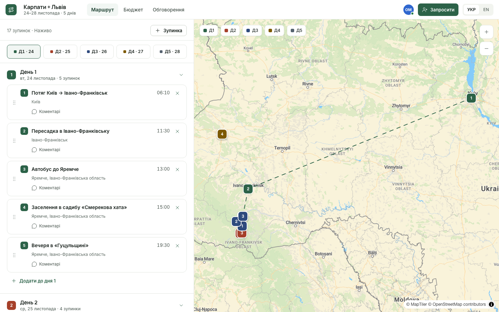
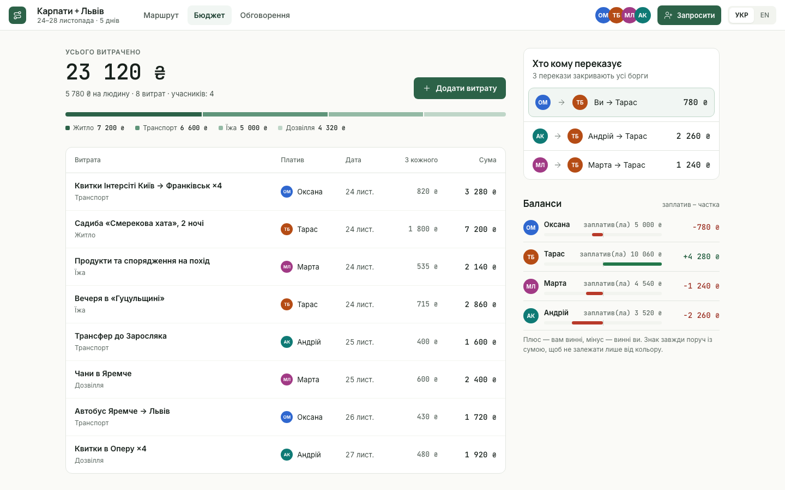
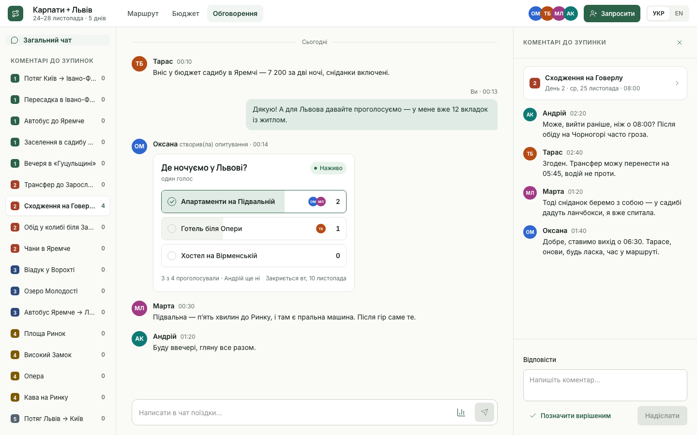
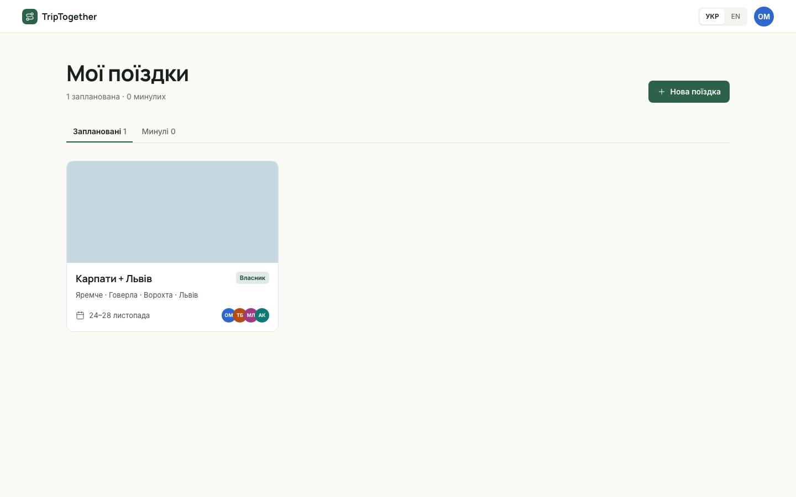
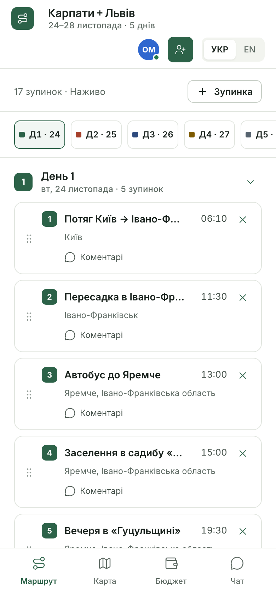
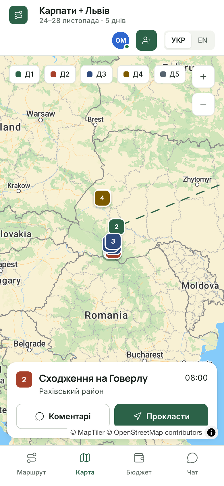
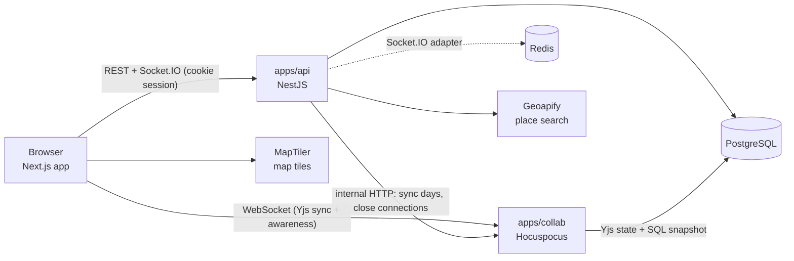

# TripTogether

Plan a trip with friends in one place: a day-by-day itinerary that everyone edits at the same time, a map, shared expenses with "who pays whom", polls and chat. Ukrainian and English, invite-only, Google sign-in.

A portfolio project. The focus is real-time engineering (CRDT editing, WebSockets, cookie sessions across services) with a moderate amount of code, and a UI that follows a written design system.

| Itinerary and map | Budget |
| --- | --- |
|  |  |

| Chat, polls and stop comments | My trips |
| --- | --- |
|  |  |

| Phone: itinerary | Phone: map |
| --- | --- |
|  |  |

## Features

- **Trips and members.** Create a trip, share an invite link (hashed token, expiry, revocable), set roles (owner / editor / viewer), remove members.
- **Itinerary.** Days are generated from the trip dates. Add, rename, time, delete and drag stops between days (mouse, touch or keyboard). Several people edit at once; avatars show who is online and an "X is editing" tag marks the stop they are in.
- **Map.** MapLibre with MapTiler tiles. Numbered pins in day colours, dashed routes, a day filter, place search (Geoapify), and list-to-map selection sync. Full-screen map with a stop sheet on phones.
- **Budget.** Expenses with equal or exact splits, category bar, balances and the shortest list of transfers. Integer minor units everywhere, no floats.
- **Discussion.** Trip chat with history paging and typing indicator, polls with live vote counts (single or multiple choice, optional close date), per-stop comment threads that can be marked resolved.
- **Accessibility and i18n.** Real buttons and tables, keyboard drag-and-drop, visible focus, text never relies on colour alone. `uk` and `en` with identical key sets checked in CI.

## Architecture



- **The itinerary is a Yjs document** (`trip:{id}`), edited through `packages/doc`, the only place that mutates it. The collab server stores the binary state and rebuilds the `Day` / `ItineraryItem` SQL snapshot after every change (debounced 2 s), so the map, search and API can read plain rows. Notes will be Tiptap fragments in the same document.
- **Everything else is REST plus a broadcast.** Chat, polls and budget need server-side validation, so the client writes over REST and the server emits the result to the trip room on Socket.IO.
- **One session for three services.** NestJS issues the cookies (15-minute access JWT, rotating refresh token with reuse detection). Socket.IO reads the cookie at connect and re-checks membership on `trip:join`. Collab takes a short-lived token from `POST /collab/token` and re-reads the role from the database on every connection, so removing a member takes effect on their next connect.
- **Roles are one service.** `MembershipService` is used by the REST guard, the Socket.IO gateway and the collab server.
- **Shared contracts.** `packages/shared` holds the zod schemas, error codes, event types and the money logic; the API returns error codes, the web app translates them.

## Repository

```
apps/web        Next.js 16 (App Router), Tailwind 4, next-intl, MapLibre, dnd-kit
apps/api        NestJS 12: auth, trips, invites, expenses, discussion, places, Socket.IO gateway
apps/collab     Hocuspocus 4: document auth, load/store, SQL snapshot, internal endpoints
packages/doc    Yjs itinerary document helpers (syncDays, addItem, moveItem, readDays)
packages/shared zod schemas, roles, error codes, event types, money and settlement logic
packages/db     Prisma 7 schema, migrations, demo seed
packages/config shared tsconfig
e2e             Playwright tests and README screenshot generator
docs            SPEC.md (product + architecture), design/DESIGN.md (design system) and boards
```

## Getting started

You need Node 24, pnpm 12 (`corepack enable pnpm`) and Docker.

```bash
pnpm install
cp .env.example .env          # then fill in the values below
docker compose up -d          # PostgreSQL 18 + Redis 8
pnpm db:migrate               # apply migrations
pnpm db:seed                  # demo trip "Карпати + Львів"
pnpm build                    # builds the packages the apps depend on

pnpm --filter @triptogether/api dev
pnpm --filter @triptogether/collab dev
pnpm --filter @triptogether/web dev      # http://localhost:3000
```

### Environment

| Variable | Needed for |
| --- | --- |
| `DATABASE_URL`, `REDIS_URL` | defaults in `.env.example` match `docker-compose.yml`; Redis is optional (Socket.IO falls back to memory) |
| `JWT_ACCESS_SECRET`, `JWT_REFRESH_SECRET`, `COLLAB_JWT_SECRET`, `COLLAB_INTERNAL_SECRET` | random strings, at least 16 characters |
| `GOOGLE_CLIENT_ID`, `GOOGLE_CLIENT_SECRET` | sign-in. Create a Web OAuth client; redirect URI `http://localhost:4000/api/v1/auth/google/callback` |
| `NEXT_PUBLIC_MAPTILER_KEY` | map tiles. Without it the map is a plain canvas and pins still work. Allow `http://localhost:3000` as origin |
| `GEOAPIFY_API_KEY` | place search. Without it you can still add stops by typing a name |

### Demo data

`pnpm db:seed` creates four demo people and a five-day trip with 17 stops (real coordinates), eight expenses, a poll with votes, chat and comments on a stop. Those demo users cannot sign in. To own the demo trip yourself, sign in with Google once, then:

```bash
SEED_OWNER_EMAIL=you@example.com pnpm db:seed -- --reset
```

## Tests

```bash
pnpm typecheck
pnpm test                                  # unit tests: money, splits, roles, invites, polls, auth, Yjs document
pnpm --filter @triptogether/e2e e2e        # Playwright: starts its own API, collab and web on other ports
pnpm --filter @triptogether/e2e screenshots   # regenerates docs/screenshots from the demo seed
```

First e2e run: `pnpm --filter @triptogether/e2e exec playwright install chromium` and create the database once: `docker compose exec postgres createdb -U triptogether triptogether_e2e`.

The e2e suite signs in through `POST /auth/e2e-login`, which exists only when `E2E=true` and `NODE_ENV` is not `production`. It covers the main flows between two browsers: invite and join, live editing and drag-and-drop, map pins, split and settlement maths, chat and polls arriving live, comment threads, roles and permissions, session refresh, and phone layout.

## Decisions worth knowing

- **Money is integers.** Equal splits give the remainder one minor unit at a time to the first participants, so parts always add up. The settlement list is a greedy debtor/creditor match with at most (people − 1) transfers. The unit tests use the design's sample data and reproduce its numbers.
- **The Yjs doc is the source of truth, SQL is a rebuildable view.** The snapshot is deleted and rewritten in one transaction on every store, so it cannot drift.
- **Non-members get 404, not 403,** for trips, messages and polls, so ids cannot be probed.
- **Refresh cookie is scoped to `/api/v1/auth`,** so the Next.js server cannot see it. The landing page and the socket therefore try the refresh from the browser.
- **maplibre's worker is served from `public/maplibre`.** The bundler rewrites its worker URL and breaks it; `scripts/copy-maplibre.mjs` copies the files before dev and build.

## Known limits

- Stop notes (Tiptap) and live mouse cursors are not built yet; presence is avatars plus the editing tag.
- No bookings, ticket import, offline mode, push notifications, PDF or calendar export (out of the MVP, see `docs/SPEC.md`).
- Expenses assume two decimal places, which is right for ₴, €, $ and zł but not for currencies like JPY.
- Chat has no @mentions, unread badges, or message edit and delete.
- Not deployed yet. The SPEC plans Vercel (web), Railway or Fly (api, collab), Neon, Upstash and a shared parent domain for cookies.
- Dark mode follows the OS and the tokens are in place, but no screen was designed for it and it has only been spot-checked.

## Docs

- [`docs/SPEC.md`](docs/SPEC.md): scope, data model, REST and Socket.IO API, Yjs design, phases and risks.
- [`docs/design/DESIGN.md`](docs/design/DESIGN.md): tokens, typography, components, screens, accessibility and open design questions.
- [`CLAUDE.md`](CLAUDE.md): working notes for the AI pair-programming setup used on this repo.
